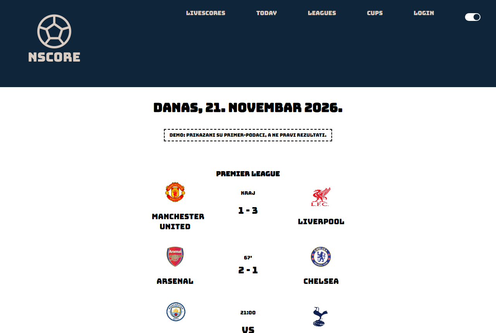

# NScore



NScore is a football scores website I made in 2022 while learning HTML, CSS and JavaScript. It has a page for live matches, a list of today's matches, and standings for the top leagues and cups. There are no frameworks and no build step.

Demo: https://dzonyv.github.io/NScore/

The demo runs on sample data from the `data/` folder. The scores and tables in it are made up, and every page that shows them says so. The 2022 version called API-Football through RapidAPI straight from the browser, with the API key in the source code. I removed the key, so the public demo works without one. The login page is a mockup and does not send anything.

## Built in 2022, without AI

I wrote the original code between March and June 2022, before ChatGPT was released. The commit dates in the history are the real ones. The tag [`v2022-original`](https://github.com/dzonyv/NScore/tree/v2022-original) points to the code as it was on 31 May 2022; the only changes there are a removed API key and removed links to personal profiles. Everything after 2022 (the fixes from 2024 and the cleanup for the public demo in 2026) is in separate commits on top of it.

## Running it locally

The pages load JSON with `fetch`, and browsers block that for files opened directly from disk (`file://`), so you need a small local server:

```
git clone https://github.com/dzonyv/NScore.git
cd NScore
python -m http.server 8000
```

Then open http://localhost:8000. Any other static server works too, for example `npx serve`.

Club and competition logos load from the API-Football media server, so they need an internet connection.

## License

MIT, see [LICENSE](LICENSE).

---

## Srpski

NScore je sajt za fudbalske rezultate koji sam napravio 2022. godine, dok sam učio HTML, CSS i JavaScript. Ima stranicu sa utakmicama uživo, listu današnjih utakmica i tabele najvećih liga i kupova. Nema frameworka ni build koraka.

Demo: https://dzonyv.github.io/NScore/

Demo koristi primer-podatke iz foldera `data/`. Rezultati i tabele u njima su izmišljeni i to piše na svakoj stranici koja ih prikazuje. Verzija iz 2022. je pozivala API-Football preko RapidAPI-ja direktno iz browsera, sa ključem u kodu. Ključ sam uklonio, pa javni demo radi bez njega. Login stranica je samo mockup i ništa ne šalje.

### Napravljeno 2022, bez AI

Originalni kod sam pisao od marta do juna 2022, pre nego što je ChatGPT izašao. Datumi commitova u istoriji su pravi. Tag [`v2022-original`](https://github.com/dzonyv/NScore/tree/v2022-original) pokazuje kod onakav kakav je bio 31. maja 2022; jedine izmene su uklonjen API ključ i uklonjeni linkovi ka ličnim profilima. Sve posle 2022. (ispravke iz 2024. i sređivanje za javni demo 2026) nalazi se u posebnim commitovima.

### Pokretanje

Stranice učitavaju JSON preko `fetch`, a browser to blokira kada se fajl otvori direktno sa diska (`file://`). Zato treba lokalni server:

```
git clone https://github.com/dzonyv/NScore.git
cd NScore
python -m http.server 8000
```

Zatim otvori http://localhost:8000.

Licenca: MIT, vidi [LICENSE](LICENSE).
